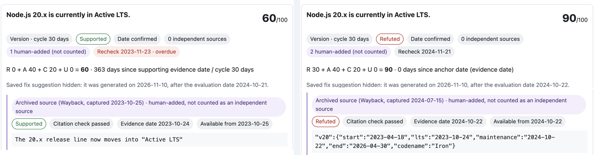

# ClaimClock

ClaimClock re-checks an old answer claim by claim and shows whether each claim still holds, with the evidence, its dates and when to look again. Tavily finds current evidence, and a local Bifrost gateway relays the Gemini calls. The public demo replays stored runs and needs no API key.

**Demo:** https://coo001.github.io/claimclock/ · **Repository:** https://github.com/coo001/claimclock



*The default sample, "Node.js 20.x is currently in Active LTS.", as the evaluation date moves from 2024-10-21 to 2024-10-22. Both items are Internet Archive (Wayback) captures: the v20.9.0 announcement captured 2023-10-25 and the official release schedule captured 2024-07-15.*

## Quick start (no keys needed)

Requirements: Node.js 22 or later. From the repository root:

```sh
npm test
npm start
```

Open `http://127.0.0.1:5173` in a browser. Pick a sample, then move the evaluation-date slider and the per-type re-check cycles: the score, timeline, re-check dates and ICS file update immediately. The first, default sample is the recorded Node.js 20.x stale-answer run. Selecting a sample or re-verifying the exact same text only replays stored output and makes no external calls.

**Typing your own paragraph.** A paragraph is shown with a result only when it exactly matches (after whitespace normalization) the text of a stored example. Matching the recorded real run replays that run's stored output; matching a fixed example shows its human-labeled example data and says it is not AI output. Any other paragraph gets no result. On the static demo (GitHub Pages) there is no backend, so the page says that no live analysis is possible there, that the paragraph was not analyzed or sent anywhere, and that live analysis requires a local install and your own API keys. With the local server but no keys configured, the page reports that live mode is not configured.

**Evidence as of the evaluation date.** An evidence item is used for an evaluation date only when both its event/publication date (if it has one) and its collection date are on or before that date; it becomes available on the later of the two. If an item has no collection time, the collection time of the enclosing result is used. An item with no defensible availability date is excluded. As a result, sources collected in 2026 are hidden in 2024 views even when they describe 2023 or 2024 events. In the default sample the two Wayback items are available from their capture-based dates (2023-10-25 and 2024-10-22) and the Tavily item from 2026-11-10, so 2024-10-21 shows Supported, 2024-10-22 shows Refuted and 2026-11-10 shows Refuted with one independent source. A saved Gemini fix suggestion is shown only from its generation date onward; if that date is unknown, it is hidden with a short note.

**Evidence provenance.** Each evidence item carries a visible badge. Items from recorded or local live runs are `External search (Tavily)`. Items in the fixed examples and the manually added timeline items are `Human-added`: they can still decide the relation and the date, but they are not counted as independent sources and do not lower the source-count component C. On 2026-11-10 the default sample therefore shows 1 independent source (the Tavily result), not 3. The manually added official Node.js v20.9.0 announcement keeps its 2023-10-24 publication date; its collection date is the Wayback capture time, 2023-10-25 18:10:12 UTC, and the schedule item's is 2024-07-15 14:09:15 UTC. They show an `Archived source (Wayback)` badge. The Node.js schedule marks 2024-10-22 as the start of Maintenance LTS; the separate v20 EOL date is 2026-04-30. The page-update date is never used as the event date.

**Browser-local batch recheck queue.** The "Batch recheck queue" panel has explicit buttons to save the current result, load all fixed examples for a demo, recheck stored records, remove one record and clear the queue. Nothing is saved automatically. Records stay in this browser's `localStorage` (versioned key `claimclock.batchQueue.v1`, at most 20 records) and are never uploaded. Batch recheck only recomputes status and priority from the evidence saved with each record, using the current evaluation date and cycles; it fetches no new evidence and never edits saved answers or evidence. Rows are sorted by highest claim score (descending), then title and id, and show the title, highest score, claim count and status counts; **Open** loads a record into the single-answer view. Unreadable or full storage is reported on the page instead of failing. The pure logic is in `lib/queue.js`.

## Status notes

- The browser UI and the pitch deck (`ClaimClock_pitch_v9.pptx`) are in English. The default Node.js sample replays a real stored Bifrost run. The pre-registered operating-path evaluation has 15 Node.js claims; results and limitations are below.
- The Pages demo is built from `main` by the manual `pages.yml` workflow. Changes on `main` appear there only after that workflow is run again.
- Older decks (`ClaimClock_pitch_v7` and `v8`) are kept only as history; `v9` is current.

## Wayback evidence in the default sample

The default sample shows the claim as true at first and false after Node.js 20 left Active LTS. This needs evidence that existed at the time, so two Internet Archive captures are added to the sample as human-added evidence. Their capture times are used as collection times; the date rules are unchanged.

| Evidence | Wayback capture (UTC) | Takes effect |
|---|---|---|
| Node.js v20.9.0 announcement: "The 20.x release line now moves into Active LTS" | 2023-10-25 18:10:12 (`https://web.archive.org/web/20231025181012/https://nodejs.org/en/blog/release/v20.9.0`) | 2023-10-25 (event 2023-10-24) |
| Official `schedule.json`: v20 `maintenance` is 2024-10-22 | 2024-07-15 14:09:15 (`https://web.archive.org/web/20240715140915/https://raw.githubusercontent.com/nodejs/Release/main/schedule.json`) | 2024-10-22 (event date) |

Both URLs were found with the Wayback CDX API and their text was read back from the captures. The slider therefore shows Insufficient evidence on 2023-10-24, Supported from 2023-10-25 to 2024-10-21, and Refuted from 2024-10-22. Archived items are human-added: they decide the relation and date but are not counted as independent sources. The Tavily result (collected 2026-11-10) appears only from that date, so the independent-source count is 0 until then and 1 on 2026-11-10.

## Recorded real runs

### Current operating-path evaluation (pre-registered, Node.js N=15)

The final, pre-registered set contains eight status-shift claims and seven stable codenames. All 15 judgments completed; 12/15 exactly matched the frozen human labels (80%), including 5/8 status shifts and 7/7 codenames. All 15 Gemini-generated Tavily queries were sent unchanged. Prompts and rules were not changed; transient 429/503 responses and retries remain in the run records. The evaluation used 18 new Tavily calls, bringing the known cumulative total to 38/50. Bifrost recorded 49 request attempts, 37 successful responses and 25,161 reported tokens. At the end of the run, the daily policy counter was 38/100 requests and 25,169/50,000 tokens (including an 8-token smoke check); the guard meter showed $0.0147018/$0.10. This is a small, Node.js-specific evaluation, not a general accuracy claim. Records: `public/live-evaluation-nodejs-v1-preregistered.json`, `public/live-evaluation-nodejs-v1.json` and `public/live-evaluation-nodejs-v1-retries.json`.

### Earlier direct-call evaluation (N=6)

On 2026-11-10, one earlier failing sample and five new samples (collected before any prompt change) were evaluated, giving six real API samples (`public/live-evaluation-pre.json`). Overall agreement was 5/6 (83.3%); the five new samples agreed 5/5. Every new sample has the human label "supported", so this is a small, single-class evaluation and is not evidence of general performance. Tavily searches: 6 for this evaluation set (1 for the earlier baseline sample + 5 new), plus 6 retries during earlier model exploration, for a cumulative 11. Prompts and rules were not changed.

Why the earlier sample scored 0/1: the official Node.js v20.9.0 announcement states "will remain so until October 2024", so the correct label is "supported". However, the Tavily results at the time were unofficial pages focused on EOL schedules that did not directly support that period, so Gemini judged the evidence insufficient. This mismatch is consistent with a retrieval problem: the official source was not among the search results for that sample. The sample was not re-evaluated after any fix.

### Earlier Bifrost demonstration (input-claim query, N=6)

On 2026-11-10, six new samples were evaluated through a local Bifrost v2.5.0 gateway using the existing `runLive` extraction and judgment path (`public/live-evaluation-bifrost-freequery-v1.json`). There are two samples per class (supported, refuted, insufficient evidence). Agreement with the human labels was 6/6 (N=6), and 2/2 for each class. The human labels were fixed before the run by checking the official source URLs directly. This run made 6 new Tavily calls, for a known cumulative total of 17 of 50. In this evaluation the transport layer sent the input claim sentence itself to Tavily; the query candidates Gemini generated are preserved separately in `results[].run.runLog.tavily[].generatedQuery`. The queries actually sent are in `results[].run.runLog.tavily[].query` and `results[].executedQueries`. The actual queries contain no `site:` filter, answer URL or domain restriction. Existing prompts and rules were not changed, and this record is separate from `live-evaluation-pre.json`. This is a small demonstration evaluation that **searched with the input claim as the query**; it does not evaluate the query quality of the operating path, where Tavily runs the Gemini-generated query. Six samples are not evidence of general performance.

Requests were authenticated with the virtual-key header (`x-bf-vk`), and `client.allow_direct_keys:false` meant the direct-key bypass was off. All 14 Gemini inference requests from the six runs succeeded, and all 14 were confirmed in Bifrost's built-in log API (`GET /api/logs`, HTTP 200) (`public/bifrost-runtime-feature.json`). One authentication smoke request (HTTP 200) is in the same log (`public/live-run-bifrost.json`). Valkey and the semantic cache were not used. When a source has no publication date, `published_date` and the evidence date stay null and are shown as "date unknown"; the page-update date is never used to guess the event date. The virtual-key value is absent from the recorded evaluation files and is not included in the repository.

The virtual-key setup probe before the evaluation (`public/bifrost-vk-link-probe.json`) is excluded from scoring. The Gemini provider key ID configured on the first virtual key was not linked, so Bifrost rejected every request with HTTP 400 (`no keys found for provider: gemini and model: gemini-3.5-flash-lite`). This probe made 0 Tavily calls and 0 Gemini provider calls and is not an evaluation sample. The evaluation above was then run with a new temporary virtual key that had the provider key ID linked.

### Direct-call records (not through Bifrost, earlier)

`public/live-run.json` records a direct Tavily + Gemini call, and `public/live-run-gemini-direct.json` records one direct Gemini call (HTTP 200). The `live-evaluation-pre.json` evaluation above also used the direct path. These records use a different execution path from the Bifrost records.

`npm run live:run` sends the fixed Node.js sample directly to the Tavily Search API and the Gemini API. It does not go through Bifrost, and it uses `TAVILY_API_KEY`, `GEMINI_API_KEY`, and `GEMINI_MODEL` (default `gemini-3.5-flash-lite`) from `.env`. The script that collected the five new samples is `node --env-file=.env scripts/live-eval-pre.mjs`; it makes exactly one Tavily call and one Gemini call per sample, with no retries. Keys are never written into the recorded JSON.

## Live local mode (optional)

The static demo page only shows stored examples and recorded runs, and keys are never sent to the browser. Running the real API scripts is separate and may fail depending on available models and account limits. If a cost or paid plan is required, check the provider's official page before going ahead.

1. To create direct-call records, copy `.env.example` to `.env` and set `TAVILY_API_KEY` and `GEMINI_API_KEY`. `.env` is not committed to git.
2. To use Bifrost, follow the official install guide and run it locally: https://docs.getbifrost.ai/quickstart/gateway/setting-up
3. Configure the Gemini provider in the Bifrost admin UI: https://docs.getbifrost.ai/providers/supported-providers/gemini. The Bifrost path uses `TAVILY_API_KEY`, `BIFROST_BASE_URL=http://localhost:8080` and `GEMINI_MODEL` from `.env`, and runs with `npm run live:run:bifrost`.
4. `npm run live:run` is the direct path and `npm run live:run:bifrost` is the gateway path. Either way, records are written to public-only files; never put key values in logs or the repository.
5. Semantic-cache performance was not measured: no Valkey/Redis runtime was reachable at `127.0.0.1:6379`. Local Bifrost configuration, databases and key files are not included in this repository. If you test caching separately, verify an actual cache hit before claiming savings.

Bifrost is an open-source gateway you can run yourself. That does not make the Gemini or Tavily inference APIs free. The app caps each input at 5 Gemini calls and 8 Tavily calls, and at 20 analyses per UTC day. 429/quota errors are not retried. Check prices and limits on each provider's official page before running.

## Sample data and limits

- Node.js 20.9.0 official release announcement and the Node.js releases table. The announcement states the codename Iron and the Active LTS period, and its publication date is 2023-10-24. The releases table's `Last updated` 2026-03-24 is a page-update date, not the EOL event date, so its evidence date is null. All evidence in this fixed example was collected on 2026-11-09 (the default recorded sample was collected on 2026-11-10, apart from its two Wayback items), so none of it appears in evaluations before that date, and the collection date is not treated as the date the fact occurred. All of it is human-added. Sources: https://nodejs.org/en/blog/release/v20.9.0 and https://nodejs.org/en/about/previous-releases
- A sample based on public Python 3.12 documentation (the answer text is a synthetic sentence written for the demo): https://docs.python.org/3/whatsnew/3.12.html
- ExampleCloud is a fully synthetic service and has no sources.

The default first sample is a `recorded-live` replay of the real Bifrost stale-claim run. It is not a new real-time Tavily/Gemini result. The other Node.js, Python and ExampleCloud samples are fixed examples. The UI shows the data type, authored date, evidence date, and collection date/method separately. If a source has no publication or event date, the date stays null and is shown as "date unknown". Collection time only limits when evidence can first be observed; it never replaces the event date. Past evaluations exclude evidence that was not yet published or not yet collected, and the date score uses only dates for evidence supporting the judged relation. Only external-search evidence counts toward independent sources. Date and relation judgments can be wrong; the score is a review priority, not a probability of truth. The public demo has no live arbitrary-input submission.

## Score definition

`R + A + C + U` (max 100): relation risk R (refuted 30, supported 0, insufficient evidence 15), age A, lack of independent sources C (external-search hosts only; human-added evidence is not counted), unknown date U (10). For insufficient evidence, A is 20. Worked examples: recent supporting evidence at 1 day on a 30-day cycle with 2 sources = 1.3; date-confirmed refutation with 2 sources = 70; insufficient evidence, unknown date, 0 sources = 65; unknown-date refutation with 1 source = 70. Relation and date are separate labels.

## Static hosting

`npm run build` copies the static files and `lib/` (including the browser-only queue helper `lib/queue.js`) into `dist/`. The GitHub Pages workflow is set up to run only on `workflow_dispatch`. The static demo ships stored, key-free run and evaluation records, including the default Node.js replay; no API keys, local Bifrost configuration or backend are included in the repository.

All page assets, module imports and data fetches use relative paths (`./…`), so the page works under the `/claimclock/` sub-path on GitHub Pages. `tests/basepath.test.js` checks this statically.

Destinations:

- Repository: https://github.com/coo001/claimclock
- Demo: https://coo001.github.io/claimclock/ (built from `main` by the manual Pages workflow; run it again after new commits)

## Verification

Run `npm test`, `npm run build`, `npm run check` and `npm run check:secrets`; what each one checks is listed below. `ClaimClock_pitch_v9.pptx` has nine English slides with real app captures from the current build (Supported on 2024-10-21, Refuted on 2024-10-22, the 2026-11-10 evidence view and the batch queue). Every slide was rendered and visually inspected with macOS Quick Look; PowerPoint and LibreOffice were not used.

`npm run build` copies `public/` and `lib/` into `dist/`. The local server also serves `/live-run.json` statically.

- `npm test`: checks fixed scoring cases, label input, fixture matching, and how the ICS changes with date and cycle changes. It also checks that undated evidence is not back-dated to a page-update date, that evidence becomes available only on the later of its event and collection dates (with the result timestamp as fallback and exclusion when neither is known), that saved fix suggestions are hidden before their generation date or when it is unknown, that evidence provenance is assigned and preserved, that human-added evidence is not counted as an independent source, and that only dates of the judged relation feed the score. `tests/queue.test.js` checks the batch queue's sorting, 20-record cap, storage error handling, and that queue operations make no fetch calls and do not mutate saved records. In a key-free environment it starts the server on port 0 and checks `/`, the static JS/CSS/fixture modules, `/api/status` (`liveReady:false`), `/api/verify` (503 `LIVE_NOT_CONFIGURED`) and the recorded JSON responses for `/live-run.json`, `/live-evaluation-pre.json`, `/live-run-bifrost.json`, `/live-run-gemini-direct.json`, `/live-evaluation-bifrost-freequery-v1.json`, `/bifrost-runtime-feature.json` and `/bifrost-vk-link-probe.json`. It checks that the first sample matches the Bifrost evaluation record exactly, that `recorded-live` mode is kept, that only the same paragraph is replayed, and that the replay notice says no external call was made; an exact-match fixed example is described as human-labeled data, not AI output. `tests/basepath.test.js` also checks that, without a backend, the page states that no live analysis is possible there and that live mode needs a local install and your own API keys. The live pipeline is only exercised with a mock fetch, so real API calls are 0. Tests make no external network calls.
- `npm run check`: syntax-checks every JS file with `node --check`.
- `npm run check:secrets`: checks that no real `.env` file other than `.env.example` exists, and that files git would commit (tracked files and new, non-ignored files) contain no strings shaped like API keys or tokens. Output shows only file paths and pattern names, never values or file contents. It judges by shape only, so false positives are possible: for example, a sample key in the docs (a long string starting with `sk-` or `AIza`) or a placeholder of 8+ characters in `.env.example` will fail. In that case, empty the value or use a placeholder shorter than 8 characters (for example `xxx`).

There are no browser end-to-end tests, and no demo video is included in this repository. The small operating-path evaluation and its limits are reported above; it is not a general benchmark.

## Current limitations (2026-11-10)

The following constraints remain; they are not presented as completed work.

- The N=15 operating-path evaluation is small and specific to Node.js release-status and codename claims; three of eight status shifts were mislabeled. It is not a general performance benchmark.
- Semantic-cache hit rate and savings were not measured because no Valkey/Redis runtime was reachable at `127.0.0.1:6379`.
- The static demo replays stored records. Live inference requires local credentials and a local gateway; no keys, Bifrost data/configuration, or gateway binary are included in the repository. The Pages demo shows the commit that was last deployed; newer commits on `main` appear only after the Pages workflow is run again.
- The batch queue only rescores evidence already saved with each record. It does not find new evidence, so a stored record cannot become fresher than its saved evidence.

## Technology and AI use

A plain Node.js HTTP server and browser JavaScript. The live AI feature passes Gemini calls through a local Bifrost gateway and uses Tavily for search. AI coding agents assisted development. Bifrost itself is Apache-2.0 open source; each dependency's license and API terms must be followed separately. The recorded real runs include earlier direct calls, an earlier six-sample Bifrost demonstration, and the separate 15-case operating-path evaluation above. The latter used a Bifrost virtual key with Gemini-generated queries sent unchanged to Tavily; its result, retries and usage counters are recorded in the linked JSON files.
